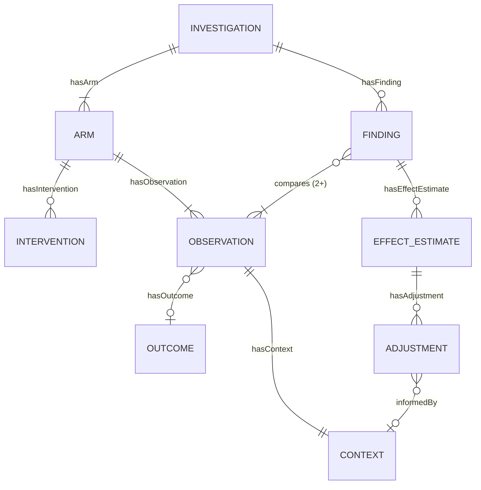

# Evidence Repository Core Vocabulary (`evrepo-core`)

Namespace: `https://vocab.evidence-repository.org/`

The core ontology is the domain-free skeleton that every sector taxonomy
(education, health, climate) plugs into. Tools learn this structure once and
can then interpret any record, whatever the domain.

## Version 2 (draft): Observation-centred model

Version 2 comes out of the DESTINY Open Data Format Hackathon. It moves the
core unit of data from the Finding to the Observation and makes Arms
first-class.

| Class | Definition | Example |
|-------|------------|---------|
| Investigation | Research reported in a reference | A journal article |
| Arm | A group of units (people, places…) in a study | Control, intervention |
| Observation | A single measurement on an arm | Blood pressure |
| Context | Population, setting and time of an observation | 400 adults, UK, post-test at 6 weeks |
| Finding | A comparison of two or more observations | Drug vs placebo |
| EffectEstimate | The quantified comparison | Risk ratio 0.8 |
| Adjustment | A characteristic an effect estimate was adjusted for | Age |

A Finding's observations may come from different Arms (treatment vs control)
or from the same Arm (pre vs post). Evidence with nothing to compare
(prevalence, qualitative) is represented by Observations alone.

### Why it changed

| Weakness in version 1 | Version 2 |
|-----------------------|-----------|
| Time was squeezed in as a kind of Condition | Time is part of an Observation's Context |
| Everything had to be "A against B" | Observations stand alone; a Finding is only needed for a comparison |
| Nowhere to say what an estimate was adjusted for | Adjustment is explicit and linked to the Context that informs it |
| Arm results were per finding, so the same arm could be described inconsistently | Arms are described once; Context sits on observations |
| Prevalence studies had no Finding to hang data on | No Finding required |
| Arm data duplicated under each Finding | Findings reference shared Observations |
| Qualitative data had nowhere to live | Representable as Observations |

### Migration from version 1

This is a breaking change. `Finding` and `Context` keep their IRIs but change
meaning, so version 1 data cannot be read as version 2 without transformation.

| Version 1 | Version 2 |
|-----------|-----------|
| `ObservedResult` | `Observation` |
| `hasArmData` (Finding → ObservedResult) | `hasArm` (Investigation → Arm) + `hasObservation` (Arm → Observation) |
| `forCondition` | Removed. An Observation belongs to its Arm. |
| `Condition`, `ControlCondition` | Removed. The group is an `Arm`; a control is an Arm with no (or a comparator) Intervention. |
| `TemporalCondition` | Removed. Use `timePoint` on the Observation's `Context`. |
| `Intervention` (subclass of Condition) | `Intervention`, standalone, attached with `hasIntervention` (Arm → Intervention) |
| `evaluates` (Finding → Condition) | `compares` (Finding → Observation, 2+) |
| `comparedTo` (Finding → Condition) | `comparedTo` (Finding → Observation): the reference observation |
| `hasContext` (Finding → Context) | `hasContext` (Observation → Context) |
| `hasOutcome` (Finding → Outcome) | `hasOutcome` (Observation → Outcome) |
| `preMean`, `preSd` | Removed. A baseline is its own Observation with a pre-test Context. |
| `derivedFrom` (→ ObservedResult) | `derivedFrom` (→ Observation) |
| — | `Adjustment`, `hasAdjustment`, `informedBy` |

Unchanged: `LinkedDataEnhancement`, `hasInvestigation`, `hasFinding`,
`hasEffectEstimate`, the CodingAnnotation pattern, summary-statistic and
effect-estimate properties, and the EffectSizeMetric and EstimateSource
schemes.

### Additions beyond the hackathon notes

The notes define the entities and their relationships but not every property
needed to serialise them. These were added to make the model usable and need
confirming:

- **`hasOutcome` on Observation, and keeping `Outcome`.** The hackathon diagram
  has no Outcome entity, but an Observation has to say what it measured.
- **`hasIntervention` on Arm, and keeping `Intervention`.** The worked examples
  label arms with their intervention; the diagram has no entity for it.
- **`comparedTo` as the reference observation.** "Compares two or more
  observations" loses the direction that version 1's `evaluates`/`comparedTo`
  gave, and without it the sign of an effect size is undefined.
- **`hasFinding` stays on Investigation.** In the diagram a Finding is reachable
  only from Observations, which gives it no home in a nested JSON-LD document.
- **`timePoint` on Context.** A free-text placeholder so the temporal
  information previously held by TemporalCondition is not lost.
- **`name`/`description` extended** to Arm, Observation, Intervention and
  Adjustment. A qualitative Observation is carried by `description` and
  `supportingText`.

### Open questions

1. **Pre/post shape.** The notes allow pre/post as either two Arms or one Arm
   observed twice "for now". Two encodings of the same study will not be
   comparable. This draft's definitions favour one Arm observed twice (time
   lives in Context) but do not forbid the other.
2. **Context is one per Observation and includes time**, so observations in
   the same arm at different time points cannot share a Context, and the
   population and setting are repeated in each. See `../esea/example-finding.jsonld`.
3. **Population appears twice**: an Arm is "a group of units" and a Context
   has a "population". Which one owns sample characteristics?
4. **`baselineAdjusted` and `clusteringAdjusted`** on EffectEstimate now overlap
   with `Adjustment`. Keep both or retire the flags?
5. **Adjustment → Context.** An adjustment for age is linked to a Context, but
   Context has no core property that holds "average age". The link currently
   identifies *where* the characteristic comes from, not its value.
6. **Roles in n-ary Findings.** A correlation Finding compares exposure and
   outcome observations, but nothing marks which is which.
7. **Domain properties on Finding.** ESEA's `sampleSize`, `attrition`, `cost`
   and `groupDifferences` have domain `Finding`; under version 2 they describe
   arms or the investigation and need re-homing by the ESEA owners.

### Not yet updated

- `docs/ontology-expressivity/` still illustrates builder patterns with
  version 1 terms (`ObservedResult`, the Condition hierarchy).
- The SHACL shapes in destiny-repository (`evrepo-core-shapes.ttl`) and the
  core terms embedded in the published ESEA and HPV vocabularies.
